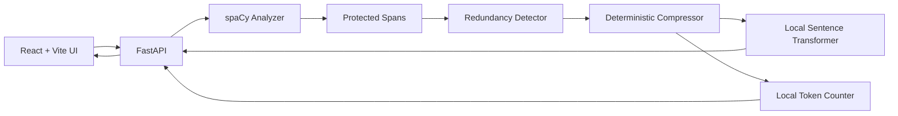

# PromptLite

PromptLite is a local, API-free intelligent prompt compression system. It reduces verbose prompts with explainable NLP while protecting intent, entities, constraints, numbers, negation, and output requirements.

## Problem
Naive stop-word removal breaks grammar and meaning. PromptLite treats compression as constrained optimization: remove redundancy only when protected information and estimated semantic preservation remain intact.

## Features
- spaCy linguistic analysis: sentence segmentation, POS, lemmas, dependencies, entities, noun phrases, negation, numbers, quotes, and task detection.
- Protected span extraction for entities, constraints, URLs, emails, numbers, quotes, and negated content.
- Safe, balanced, and aggressive deterministic compression modes.
- Local Sentence Transformers semantic similarity and sentence redundancy detection.
- Automatic fallback to a safer mode below the mode threshold.
- Local `tiktoken` counting with a transparent approximation fallback.
- TXT and PDF document extraction with file-size/type validation.
- Explainability data and measurable response metrics.

## Architecture


## Setup

### Backend
Use Python 3.11 or newer.

```powershell
cd backend
python -m venv .venv
source .venv/Scripts/activate
pip install -r requirements.txt #skip if already installed
python -m spacy download en_core_web_sm #skip if already installed
uvicorn app.main:app --reload --port 8000
```

The first Sentence Transformers request may download `all-MiniLM-L6-v2` into the local cache. For restricted environments the app falls back to a local lexical cosine similarity implementation and remains functional.

The first Balanced/Aggressive request loads the local LLMLingua-2 checkpoint (`microsoft/llmlingua-2-xlm-roberta-large-meetingbank`, ~2 GB) into the same cache; if it cannot load (disk/RAM limits, or `PROMPTLITE_DISABLE_LLMLINGUA=1`), those modes gracefully fall back to the deterministic spaCy pipeline.

### Frontend
In a second terminal:

```powershell
cd frontend
npm install
npm run dev
```

Open `http://localhost:5173`.

## API

```powershell
curl -X POST http://localhost:8000/api/compress `
  -H "Content-Type: application/json" `
  -d '{"text":"Could you please analyze these reviews carefully? Do not remove review 42.","mode":"balanced"}'
```

`GET /api/health` reports the active spaCy pipeline, embedding status, and tokenizer. `POST /api/upload` accepts `.txt` and `.pdf` files and a `mode` form field.

## Evaluation metrics
- Original and optimized estimated token counts.
- Token reduction percentage and compression ratio.
- Cosine similarity between original and optimized text, presented as estimated semantic preservation.
- Protected item and removal/consolidation evidence.

## Tests

```powershell
cd backend
pytest
```

## Limitations and future scope
Semantic similarity is an approximation, not a proof of equivalent meaning. Deterministic NLP compression cannot match every capability of a generative LLM. Different LLM tokenizers produce different token counts, and compression effectiveness depends on the structure and verbosity of input. Future work could add domain-specific protection dictionaries, relevance-ranked document chunks, multilingual pipelines, and human evaluation datasets.
