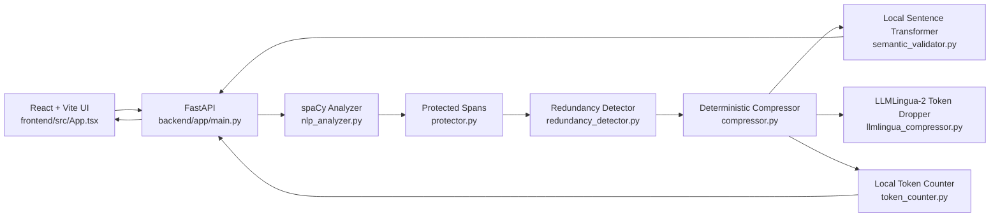

# PromptLite — Technical Architecture

> Local, API-free intelligent prompt compression system. Reduces verbose prompts with explainable NLP while protecting intent, entities, constraints, numbers, negation, and output requirements.

**Repository root:** `nlp project/`
**Components:** `backend/` (FastAPI + NLP pipeline) + `frontend/` (React + Vite UI)
**Design philosophy:** compression as *constrained optimization* — remove redundancy only when protected information and estimated semantic preservation remain intact. Naive stop-word removal is explicitly rejected because it breaks grammar and meaning.

---

## Table of Contents

1. [System Overview](#1-system-overview)
2. [Tech Stack](#2-tech-stack)
3. [Repository Structure](#3-repository-structure)
4. [NLP Techniques Used](#4-nlp-techniques-used)
5. [Libraries](#5-libraries)
6. [NLP Pipeline — End to End](#6-nlp-pipeline--end-to-end)
7. [Compression Modes & Engines](#7-compression-modes--engines)
8. [Semantic Validation & Safety Fallback](#8-semantic-validation--safety-fallback)
9. [Token Counting](#9-token-counting)
10. [Document Ingestion](#10-document-ingestion)
11. [API Contracts](#11-api-contracts)
12. [Frontend Architecture](#12-frontend-architecture)
13. [Explainability & Evaluation Metrics](#13-explainability--evaluation-metrics)
14. [Error Handling, Validation & Security](#14-error-handling-validation--security)
15. [Performance, Caching & Resource Profile](#15-performance-caching--resource-profile)
16. [Testing](#16-testing)
17. [Limitations & Future Scope](#17-limitations--future-scope)

---

## 1. System Overview

### 1.1 What the system does

User submits verbose natural-language prompt (typed/pasted text or `.txt`/`.md`/`.pdf` upload) + a compression mode (`safe | balanced | aggressive`). Backend runs a 8-stage local NLP pipeline — **input → understand → protect → detect redundancy → compress → validate meaning → count tokens → respond** — and returns the optimized prompt plus explainability data (detected task, protected items, removed/consolidated items, warnings, metrics).

No LLM rewrite call is made. No API key, no network inference. All models run on CPU locally.

### 1.2 High-level architecture



### 1.3 Request flow

```
frontend/src/App.tsx
  → POST /api/compress { text, mode, task? }
  → POST /api/upload (multipart: file + mode + task?)
    → backend/app/main.py::run_compression(text, mode)
      → NLPAnalyzer.analyze()
      → SpanProtector.protect()
      → RedundancyDetector.detect()
      → PromptCompressor.compress()  [safe]
         or LLMLinguaCompressor.compress()  [balanced/aggressive, fallback to deterministic]
      → SemanticValidator.similarity() + floor check + softening
      → LocalTokenCounter.count() × 2
      → CompressResponse JSON
  → UI renders optimized text + metrics + "What changed?" panel
```

`run_compression()` in `backend/app/main.py:44-93` is the single orchestration point for both endpoints.

### 1.4 Key design decisions

| Decision | Rationale |
|---|---|
| Deterministic rule pipeline as default/safety net | Grammatical, explainable, zero-model-risk; every removal is logged by rule name |
| LLMLingua-2 extractive token dropping for Balanced/Aggressive | Information-theoretic compression (keep-fraction) achieves 40–65% reduction that rules alone cannot; still local/CPU, no generation hallucination |
| Protected-span contract (pin + guarantee) | Entities, numbers, negations, constraints, URLs, emails, quotes can never be silently dropped |
| Semantic floor + automatic softening | Cosine similarity gate per mode; below floor → recompress one level safer and keep the better score |
| Graceful degradation everywhere | Blank spaCy pipeline, lexical TF-cosine fallback, word-count token approximation, deterministic fallback if LLMLingua missing — app always stays functional |

---

## 2. Tech Stack

### 2.1 Backend

| Layer | Technology | Notes |
|---|---|---|
| Language | Python 3.11+ | Required version per README |
| Web framework | FastAPI ≥ 0.115 + Uvicorn ≥ 0.30 (standard) | `backend/app/main.py`; CORS restricted to `http://localhost:5173`, `http://127.0.0.1:5173` |
| Validation | Pydantic ≥ 2.8 | `backend/app/schemas/api.py`; request/response models |
| Linguistic pipeline | spaCy ≥ 3.8, model `en_core_web_sm` | Tokenization, POS, dependencies, NER, sentence segmentation, noun chunks, lemmas |
| Sentence embeddings | Sentence-Transformers ≥ 3.0 + Torch ≥ 2.2, model `all-MiniLM-L6-v2` | 384-dim normalized embeddings, CPU; local HF cache; lexical fallback if unloadable |
| Extractive compression | LLMLingua ≥ 0.2.2, checkpoint `microsoft/llmlingua-2-xlm-roberta-large-meetingbank` (~2 GB, ~560M params) | Token-classification dropper; fallback checkpoint `.../llmlingua-2-bert-base-multilingual-cased-meetingbank`; disabled via `PROMPTLITE_DISABLE_LLMLINGUA=1` |
| Similarity math | scikit-learn ≥ 1.5 (available), `math.sqrt` TF-cosine hand-rolled | Pairwise redundancy + preservation scoring; fallback needs no sklearn |
| Token counting | tiktoken ≥ 0.7 (`cl100k_base`) | Transparent `words × 1.3` fallback |
| Document parsing | pypdf ≥ 5.0, `python-multipart` ≥ 0.0.9 | PDF page text extraction; multipart upload |
| Testing | pytest ≥ 8.0, httpx ≥ 0.27, Starlette TestClient | `backend/tests/test_pipeline.py`, `backend/pytest.ini` |

### 2.2 Frontend

| Layer | Technology | Notes |
|---|---|---|
| Language | TypeScript | Strict via `tsconfig.*` |
| Framework | React (latest) + ReactDOM | Functional components + hooks (`useState`, `useRef`) |
| Build | Vite (latest) + `@vitejs/plugin-react` | Dev server `http://localhost:5173`; `npm run dev / build / preview` |
| Styling | TailwindCSS (latest) + `@tailwindcss/vite` + `frontend/src/styles.css` | Custom `app-shell / hero / workspace / panel` design system |
| Animation | Framer Motion (latest) | `motion.pre`, `AnimatePresence` for output, results, changes panel |
| Icons | Lucide-React (latest) | `ArrowRight, Check, Clipboard, FileUp, LockKeyhole, MousePointer2, ScanSearch, ShieldCheck, Trash2` |
| Config | `VITE_API_URL` env (default `http://localhost:8000/api`) | Consumed in `frontend/src/services/api.ts:2` |

### 2.3 Runtime topology

- Two processes: `uvicorn app.main:app --reload --port 8000` (backend) + `npm run dev` (frontend Vite).
- Browser → Vite (`:5173`) → `fetch` → FastAPI (`:8000/api/*`). CORS allows only the two localhost origins.
- All ML inference is in-process (no sidecar/model server). First Balanced/Aggressive request lazily loads LLMLingua-2; first similarity request loads MiniLM (both into `~/.cache/huggingface`).

---

## 3. Repository Structure

```
nlp project/
├── architecture.md              # this file
├── README.md                    # setup, features, API, metrics
├── HOW_IT_WORKS.md              # narrative pipeline walkthrough + worked example
├── .gitignore
├── backend/
│   ├── requirements.txt
│   ├── pytest.ini
│   ├── README.md
│   ├── app/
│   │   ├── main.py              # FastAPI app, singletons, run_compression(), routes
│   │   ├── api/__init__.py      # (placeholder)
│   │   ├── schemas/api.py       # CompressRequest/Response, HealthResponse, CompressionMode
│   │   └── services/
│   │       ├── nlp_analyzer.py          # NLPAnalyzer + Analysis dataclass + task detection
│   │       ├── protector.py             # SpanProtector + ProtectedSpans
│   │       ├── redundancy_detector.py   # RedundancyDetector + RedundancyReport, FILLER/MULTIWORD/LEADINS
│   │       ├── compressor.py            # PromptCompressor (deterministic rules)
│   │       ├── llmlingua_compressor.py  # LLMLinguaCompressor (Balanced/Aggressive engine)
│   │       ├── semantic_validator.py    # SemanticValidator (MiniLM + lexical fallback)
│   │       ├── token_counter.py         # LocalTokenCounter (tiktoken + approximation)
│   │       └── document_processor.py    # DocumentProcessor (txt/md/pdf extract + clean)
│   └── tests/
│       └── test_pipeline.py     # 5 pipeline/API tests
└── frontend/
    ├── package.json
    ├── vite.config.ts
    ├── index.html
    ├── src/
    │   ├── App.tsx              # full UI: hero, workspace, control column, results, how/about
    │   ├── main.tsx
    │   ├── types.ts             # Mode, CompressionResult (mirrors CompressResponse)
    │   ├── services/api.ts      # compress(), upload() fetch wrappers
    │   ├── components/GlassNavbar.tsx
    │   └── styles.css
    └── dist/                    # build output
```

---

## 4. NLP Techniques Used

### 4.1 Linguistic analysis (spaCy `en_core_web_sm`)

File: `backend/app/services/nlp_analyzer.py:18-49`.

| Technique | spaCy API | Purpose in PromptLite |
|---|---|---|
| Sentence segmentation | `doc.sents` | Splits prompt into `Analysis.sentences`; unit of duplicate detection, removal, and task prefixing |
| Tokenization | `self.nlp(text)` → `doc` | Foundation for every downstream signal |
| Part-of-speech tagging | `token.pos_ == "VERB"` | Finds imperative/action verbs |
| Dependency parsing | `token.dep_ == "neg"`, `token.dep_ == "ROOT"` | Negation scope (`neg` dependents) + imperative verbs (`ROOT` verbs → lemmatized via `token.lemma_`) |
| Lemmatization | `token.lemma_` | Normalizes action verbs (`identify`, `analyze`) |
| Named Entity Recognition | `doc.ents` | `PERSON/ORG/GPE/DATE/...` → protected spans (never removed) |
| Noun-phrase chunking | `doc.noun_chunks` | Captures topical phrases; blank-pipeline fallback uses `is_alpha and len > 2` tokens (`nlp_analyzer.py:34-36`) |
| Lexical attributes | `token.like_num` | Numbers, quantities, dates, IDs (`42`, `10`) → protected |
| Lexical cue lists | `{"not","never","without","no"}` | Sentence-level negation catch beyond `dep_ == "neg"` (`nlp_analyzer.py:37`) |

**Fallback:** if `spacy.load("en_core_web_sm")` fails, a blank English pipeline + `sentencizer` is used (`model_name = "spacy blank English"`). NER/noun-chunks degrade gracefully; regex/task/number/quote layers still function.

### 4.2 Pattern-based NLP (regex layer)

Regex is a first-class technique here, not an afterthought:

- **Quotes:** `["']([^"']+)["']` (`nlp_analyzer.py:39`) — verbatim user content → protected.
- **Constraints:** `\b(do not|don't|must|only|at least|no more than|return exactly|in json|include|exclude|required)\b` (`nlp_analyzer.py:41`) — instruction sentences → protected whole.
- **Task classification:** ordered first-match over 10 classes (`nlp_analyzer.py:44-49`):

  | Task | Trigger pattern |
  |---|---|
  | Summarization | `summarize\|summary\|brief\|key points` |
  | Explanation | `explain\|clarify\|why\|how does` |
  | Analysis | `analy[sz]e\|analysis\|evaluate\|insight` |
  | Comparison | `compare\|contrast\|difference\|versus\|vs\.` |
  | Classification | `classif\|categorize\|label\|sentiment\w*` |
  | Extraction | `extract\|identify\|list\|find` |
  | Question answering | `answer\|question\|what is\|who is` |
  | Code generation | `code\|function\|program\|implement\|sql\|python` |
  | Writing / rewrite | `write\|rewrite\|draft\|compose\|edit` |
  | Translation | `translat\|language\w*` |
  | Other / general | (no match) |

- **Protection extras** (`protector.py:18`): URLs (`https?://\S+`), emails (`[\w.+-]+@[\w.-]+\.[A-Za-z]{2,}`), multi-word capitalized names (`\b[A-Z][A-Za-z]+(?:\s+[A-Z][A-Za-z]+)+\b` → `Microsoft Azure`).
- **Filler / verbosity lexicons** (`redundancy_detector.py:12-76`): `FILLER` (politeness + hedging: `could you please`, `i would like you to`, `if possible`, `kindly`, `in fact`, `basically`, …), `INTENSIFIERS` (`very|really|quite|…`), `MULTIWORD` map (31 entries: `a large number of → many`, `due to the fact that → because`, `in order to → to`, `make sure → ensure`, `prior to → before`, …), `LEADINS` (polite prefaces: `please note that`, `i think that`, `can you`, …), `REQUIREMENT` (`please make sure/ensure/confirm/be certain that`), `MANNER_ADVERBS` + `MANNER_PHRASE` (`in a … way/manner/fashion`).

### 4.3 Distributional semantics (embeddings + cosine similarity)

File: `backend/app/services/semantic_validator.py:1-44`.

- **Model:** `sentence-transformers/all-MiniLM-L6-v2` on CPU, 384-dim, L2-normalized (`normalize_embeddings=True`); cosine = dot product, clamped to `[0,1]` (`similarity()`, `pairwise()`).
- **Use 1 — redundancy:** pairwise sentence matrix; later duplicate dropped if `score ≥ threshold` (safe `0.94` / balanced `0.88` / aggressive `0.80`).
- **Use 2 — preservation:** `similarity(original, optimized)` → reported as *estimated semantic preservation %*; gated against floors (safe `0.90` / balanced `0.80` / aggressive `0.68`).
- **Fallback:** local lexical TF-cosine over `[a-z0-9']+` tokens (`_lexical_vector`, `_fallback_similarity`). No sklearn/numpy dependency at inference; identical interface. Empty-input edge case returns `1.0` iff strings equal else `0.0`. `model_name` flips to `"local lexical fallback"` and `GET /api/health` reports `embedding_available=false`.

### 4.4 Information-theoretic extractive compression (LLMLingua-2)

File: `backend/app/services/llmlingua_compressor.py:1-161`.

- **Model:** Microsoft `llmlingua-2-xlm-roberta-large-meetingbank` — XLM-RoBERTa-large token classifier trained to keep high-surprisal/informative tokens and drop low-information ones at a target keep-rate. No text generation → no hallucination by construction.
- **Keep-rates:** `balanced: 0.6` (~40% fewer tokens), `aggressive: 0.35` (~65% fewer, intentionally terse "caveman" style).
- **Protection integration (2 layers):**
  1. *Pinning:* up to 100 protected spans (verbatim substrings, longest-first, `MAX_FORCE_TOKENS=100`) passed as `force_tokens` + `force_reserve_digit=True` pins every digit-containing token.
  2. *Guarantee:* post-compression case-insensitive check; any missing span re-appended under `Preserved: …` and reported.
- **Post-processing:** `_retokenize()` fixes extractive gluing (`Contactsupport@x.com`, `insights.Do`) via protected-span boundary regexes + sentence-spacing fix + whitespace collapse.
- **Guards:** inputs < 60 chars skip LLMLingua (compress poorly); load/inference failure returns `(None, reason)` → deterministic fallback + warning. Env: `PROMPTLITE_LLMLINGUA_MODEL` override, `PROMPTLITE_DISABLE_LLMLINGUA=1` force-deterministic.

### 4.5 Text normalization / cleanup

- Document cleaning (`document_processor.py:16-17`): collapse 3+ newlines → 2, collapse tabs/spaces, strip.
- Compressor punctuation repair (`compressor.py:68-78`): attach orphan punctuation, collapse 2+ spaces, dedupe articles (`a|an|the` doubling), dedupe `,/;` and `and/or/but` doubling, strip leading/trailing `,;:.`.

---

## 5. Libraries

### 5.1 Backend (`backend/requirements.txt`)

| Package | Version pin | Used in | Role |
|---|---|---|---|
| `fastapi` | ≥ 0.115 | `main.py` | Routing (`GET /api/health`, `POST /api/compress`, `POST /api/upload`), Pydantic validation, OpenAPI |
| `uvicorn[standard]` | ≥ 0.30 | runtime | ASGI server (`--reload --port 8000`) |
| `pydantic` | ≥ 2.8 | `schemas/api.py` | `CompressRequest` (`text 1–200k chars`, `mode`, `task ≤ 2000`), `CompressResponse`, `HealthResponse` |
| `spacy` | ≥ 3.8 | `nlp_analyzer.py` | Full linguistic pipeline; `en_core_web_sm` model (`python -m spacy download en_core_web_sm`) |
| `sentence-transformers` | ≥ 3.0 | `semantic_validator.py` | MiniLM embedding encode |
| `torch` | ≥ 2.2 | transitive | CPU backend for MiniLM + LLMLingua-2 |
| `llmlingua` | ≥ 0.2.2 | `llmlingua_compressor.py` | `PromptCompressor(use_llmlingua2=True, device_map="cpu")`, `compress_prompt([text], rate, force_tokens, force_reserve_digit)` |
| `scikit-learn` | ≥ 1.5 | available | Standard cosine/similarity toolkit (fallback hand-rolled so inference never hard-depends on it) |
| `pypdf` | ≥ 5.0 | `document_processor.py` | `PdfReader(BytesIO).pages → extract_text()` |
| `python-multipart` | ≥ 0.0.9 | `main.py:upload()` | Multipart form parsing (`file`, `mode`, `task`) |
| `tiktoken` | ≥ 0.7 | `token_counter.py` | `cl100k_base` encode → token counts |
| `pytest` | ≥ 8.0 | `tests/` | Test runner |
| `httpx` | ≥ 0.27 | tests | Required by Starlette `TestClient` |

### 5.2 Frontend (`frontend/package.json`)

| Package | Role |
|---|---|
| `react`, `react-dom` | UI rendering, hooks |
| `vite`, `@vitejs/plugin-react` | Dev server + build |
| `typescript`, `@types/react`, `@types/react-dom` | Type safety (`tsc -b && vite build`) |
| `tailwindcss`, `@tailwindcss/vite` | Utility styling + Vite plugin |
| `framer-motion` | Output/results/changes animations |
| `lucide-react` | Icon set |

---

## 6. NLP Pipeline — End to End

All stages orchestrated by `run_compression()` (`backend/app/main.py:44-93`). Module singletons (`analyzer`, `validator`, `protector`, `detector`, `compressor`, `llm_compressor`, `tokens`, `documents`) are created once at import so models load once.

### Stage 0 — Input & document ingestion

- **Text path** (`POST /api/compress`, `main.py:95-98`): optional `task` field prepended as `"{task}\n\n{text}"`.
- **File path** (`POST /api/upload`, `main.py:100-113`): reads bytes → 10 MB limit (else `413`) → `DocumentProcessor.extract()` decodes `.txt`/`.md` as UTF-8 (`errors="replace"`) or concatenates `pypdf` page texts for `.pdf`; unsupported suffix → `ValueError` → `415`. `clean()` normalizes whitespace. Optional `task` prepended as `"Task: {task}\n\n{text}"`.
- **Empty guard:** whitespace-only text → `422`.

### Stage 1 — Understand (`nlp_analyzer.py`)

`NLPAnalyzer.analyze(text) → Analysis(text, sentences, entities, noun_phrases, negations, numbers, quotes, imperative_verbs, constraints, task)`.

Produces every signal the later stages consume. See §4.1–4.2 for the exact rules. Task label drives the `Task: ` prefix behavior in the compressor and is surfaced in the UI.

### Stage 2 — Protect (`protector.py`)

`SpanProtector.protect(analysis) → ProtectedSpans(items, patterns)`.

Concatenates entities + numbers + quotes + negated sentences + constraint sentences + regex URLs/emails/capitalized-names; strips, drops empties, dedupes order-preserved (`dict.fromkeys`). Example: `Do not remove 42 records from Microsoft Azure` protects `42`, `Microsoft Azure`, and the full `Do not…` sentence (covered by `tests/test_pipeline.py:test_protected_items`).

`patterns` is a fixed descriptor list (`entities, numbers, dates, URLs, email addresses, quotes, negations, constraints`) documenting *categories* protected.

### Stage 3 — Detect redundancy (`redundancy_detector.py` + `semantic_validator.py`)

`RedundancyDetector.detect(sentences, mode) → RedundancyReport(duplicate_indexes, filler_matches, consolidated)`.

1. **Filler matches:** `FILLER.findall(" ".join(sentences))` — recorded for the compressor to strip and for the explainability log.
2. **Duplicate sentences:** if > 1 sentence, `validator.pairwise(sentences)` cosine matrix; any `j > i` with `matrix[i][j] ≥ threshold(mode)` added to `duplicate_indexes` (later index dropped). Thresholds: safe `0.94`, balanced `0.88`, aggressive `0.80`.
3. **Consolidation notes:** if care/detail cue words (`careful|detailed|thorough`) appear in > 1 sentence, emits `"Repeated care/detail instructions consolidated"`.

### Stage 4 — Compress (dual engine)

**Engine A — deterministic spaCy pipeline** (`compressor.py:9-86`), used for `safe` and as fallback:

1. Drop `duplicate_indexes` sentences.
2. Strip each `filler_matches` phrase (`\b…\b[, ]*`); log `Conversational filler: …`.
3. `MULTIWORD` simplification, `passes = 1` (safe/balanced) or `2` (aggressive); log `Verbose construction simplified: src -> tgt`.
4. Strip `LEADINS` prefaces; log per-pattern.
5. Strip `REQUIREMENT` phrases.
6. Balanced+ strips hedge words (`please|kindly|essentially|…`); aggressive additionally strips `INTENSIFIERS`, extra hedge adverbs, `MANNER_PHRASE` (`in a … way`), `MANNER_ADVERBS`.
7. Punctuation/whitespace repair (see §4.5).
8. Prefix `{Task}: ` iff task ≠ `Other / general` and > 1 sentence and output doesn't already start with `Word: `.

**Engine B — LLMLingua-2** (`llmlingua_compressor.py:121-161`), used for `balanced`/`aggressive` when available:

- Resolves `rate` from `MODE_RATES`; rejects unknown modes and < 60-char inputs.
- Lazy-loads model thread-safely (`_ensure_loaded`, `threading.Lock`); tries default then fallback checkpoint.
- Computes `force_tokens` (longest-first verbatim protected spans ∩ text, ≤ 100), calls `compress_prompt([text], rate, force_tokens, force_reserve_digit=True)`, joins list outputs, retokenizes, re-attaches missing spans under `Preserved: …`.
- Returns `(compressed, note)` or `(None, reason)`; caller (`main.py:59-67`) falls back to Engine A + warning on `None`.

Every removal logged into `removed_items_summary` (engine name + per-rule entries + consolidation notes) — the UI's "What changed?" source.

### Stage 5 — Validate & fail safe (`main.py:68-78`, `semantic_validator.py`)

- `score = validator.similarity(text, optimized)` (0–1 cosine).
- Floors: `SIMILARITY_FLOOR = {safe: .90, balanced: .80, aggressive: .68}` (`main.py:29`). Balanced/Aggressive floors are lower because extractive "caveman" output scores lower than grammatical rewrites by design.
- If `score < floor` and mode ≠ safe: recompress one level safer (`balanced → safe`, `aggressive → balanced`), rescore, keep whichever scored higher, set `used_mode` accordingly, append `Compression was softened to …` warning. Returned `mode_used` always reflects what actually ran.

### Stage 6 — Count tokens (`token_counter.py`)

`LocalTokenCounter`: `tiktoken cl100k_base` encode length when importable (name `"tiktoken cl100k_base"`), else `max(1, round(words × 1.3))` (name `"word-piece approximation"`). Empty → 0.

`run_compression` computes `original_count`, `optimized_count`, `reduction = (1 − opt/orig) × 100` (floored at 0, 1 decimal), `compression_ratio = opt/orig` (3 decimals).

### Stage 7 — Respond (`schemas/api.py:11-22`)

`CompressResponse`: `optimized_text, original_tokens, optimized_tokens, token_reduction_percentage, compression_ratio, semantic_similarity (score×100, 1 decimal), detected_task, protected_items, removed_items_summary ([Engine: …] + removed + consolidated), warnings, mode_used`.

Health (`main.py:31-42`): `status, spacy_model, embedding_model, embedding_available, tokenizer, llmlingua_available, llmlingua_model, llmlingua_error` — full introspection of which models/fallbacks are active.

---

## 7. Compression Modes & Engines

| Mode | Engine | Behavior | Similarity floor | Duplicate threshold |
|---|---|---|---|---|
| `safe` | spaCy deterministic only | Grammatical, conservative: 1 multiword pass, no hedge/intensifier stripping beyond filler+leadins | 0.90 | 0.94 |
| `balanced` (recommended) | LLMLingua-2 keep-rate `0.6` → fallback deterministic (1 pass + hedge trim) | ~40% fewer tokens; protected pinning + guarantee | 0.80 | 0.88 |
| `aggressive` | LLMLingua-2 keep-rate `0.35` → fallback deterministic (2 passes + intensifier/manner trim) | ~65% fewer, intentionally terse | 0.68 | 0.80 |

Short inputs (< 60 chars) always use deterministic even in balanced/aggressive. Any LLMLingua load/inference failure → deterministic + warning (`LLMLingua unavailable (…)`) — never a 500.

---

## 8. Semantic Validation & Safety Fallback

- **Metric:** cosine similarity between original and optimized embeddings (MiniLM normalized dot product; lexical TF-cosine fallback). Presented as *estimated semantic preservation %*.
- **Why floors differ:** extractive dropping is ungrammatical by design and embeds farther from the original than a rule-based grammatical edit; floors are calibrated per engine (0.90 / 0.80 / 0.68).
- **Softening logic** (`main.py:70-78`): single-step downgrade, keep-best-score, warning appended, `mode_used` updated. Safe mode never softens further (it's the floor).
- **Honesty:** README + HOW_IT_WORKS + UI label all call it an *estimate/approximation*, not a proof of equivalence.

---

## 9. Token Counting

- **Primary:** `tiktoken` `cl100k_base` (GPT-3.5/4 family estimator). `len(encoding.encode(text))`.
- **Fallback:** `round(words × 1.3)` — same formula mirrored in frontend live estimate (`App.tsx:16`) so pre-compression estimate matches backend approximation when tiktoken is absent.
- **Reported:** `original_tokens`, `optimized_tokens`, `token_reduction_percentage`, `compression_ratio`. Reduction floored at `0.0` (never negative if output grew, e.g. via `Preserved:` re-attachment or `Task: ` prefix).

---

## 10. Document Ingestion

`backend/app/services/document_processor.py:5-17`.

- `.txt`/`.md`: UTF-8 decode with `errors="replace"`.
- `.pdf`: `pypdf.PdfReader(BytesIO(content))`, `"\n".join(page.extract_text() or "")`.
- Other extensions → `ValueError("Unsupported file type…")` → HTTP `415`.
- `clean()`: `\n{3,} → \n\n`, `[ \t]+ → " "`, strip.
- Size/type validation at route level: > 10 MB → `413`; bad mode → `422`.

---

## 11. API Contracts

Base URL: `http://localhost:8000/api` (override via `VITE_API_URL`).

### `GET /api/health → HealthResponse`

Reports live backend capability: spaCy model name (or `"spacy blank English"`), embedding model name (or `"local lexical fallback"`), `embedding_available`, tokenizer name, `llmlingua_available`, `llmlingua_model`, `llmlingua_error`.

### `POST /api/compress → CompressResponse`

```json
{ "text": "Could you please analyze these reviews carefully? Do not remove review 42.", "mode": "balanced", "task": null }
```

- `text`: 1–200,000 chars (Pydantic `min_length=1, max_length=200_000`).
- `mode`: `safe | balanced | aggressive` (default `balanced`).
- `task`: optional ≤ 2000 chars, prepended to text.

```powershell
curl -X POST http://localhost:8000/api/compress `
  -H "Content-Type: application/json" `
  -d '{"text":"Could you please analyze these reviews carefully? Do not remove review 42.","mode":"balanced"}'
```

### `POST /api/upload → CompressResponse`

Multipart form: `file` (`.txt`/`.pdf`), `mode` (default `balanced`), `task?`. Same response shape; `text` derived from extracted document.

### Error codes

| Code | When |
|---|---|
| `422` | Empty/whitespace text; invalid mode; Pydantic length violations |
| `413` | File > 10 MB |
| `415` | Unsupported file type |

---

## 12. Frontend Architecture

Files: `frontend/src/App.tsx`, `services/api.ts`, `types.ts`, `components/GlassNavbar.tsx`, `styles.css`.

- **State** (`App.tsx:12`): `text, mode, result, busy, error, copied, showChanges, fileRef`.
- **Actions:** `doCompress()` (validates non-empty → `compress(text, mode)`), `doUpload(file)` (sets `text = "Document: " + name`, stores result), `copy()` (clipboard + 1.8s confirmation).
- **Layout:** `GlassNavbar` → `hero` (eyebrow, headline, proof badges: No API keys / Real NLP pipeline / Meaning checked) → `workspace` (input panel + control column + output panel) → error → animated `results` (token reduction %, semantic preservation %, before → after) → collapsible `changes` (detected task, mode used, protected items ≤ 8, removed/consolidated, warnings) → `how` (4 stages) → `about` → footer.
- **Input panel:** textarea, live token estimate (`words × 1.3`), Paste (clipboard read), Upload (hidden file input, `.txt,.pdf`), char count, Clear.
- **Control column:** 3-button mode switch (Safe = Maximum preservation, Balanced = Recommended, Aggressive = Stronger reduction), Compress (spinner while `busy`), Load-example-prompt.
- **Output panel:** `motion.pre` optimized text or empty-state placeholder; Copy button.
- **API layer** (`services/api.ts`): `compress()` posts JSON, `upload()` posts `FormData`; both throw `Error(body.detail)` on non-OK.
- **Types** (`types.ts`): `Mode` union + `CompressionResult` mirroring `CompressResponse` 1:1.

---

## 13. Explainability & Evaluation Metrics

Every response carries its own audit trail:

| Field | Meaning |
|---|---|
| `detected_task` | 10-class regex classifier output (or `Other / general`) |
| `protected_items` | Verbatim no-touch spans (entities, numbers, quotes, negations, constraints, URLs, emails, capitalized names) |
| `removed_items_summary` | `[Engine: …]` + per-rule entries (`Conversational filler: …`, `Verbose construction simplified: a → b`, `Redundant preface removed: …`, hedge/intensifier notes, LLMLingua keep-rate note) + consolidation notes |
| `warnings` | LLMLingua fallback notice, semantic softening notice |
| `mode_used` | What actually ran (may differ from requested after softening) |
| `token_reduction_percentage` | `(1 − opt/orig) × 100`, 1 decimal, floored at 0 |
| `compression_ratio` | `opt/orig`, 3 decimals |
| `semantic_similarity` | Cosine × 100, 1 decimal, labeled *estimated* |

---

## 14. Error Handling, Validation & Security

- **Validation:** Pydantic bounds on `text`/`task`/`mode`; route-level mode check on upload; empty-text `422`; file size/type gates.
- **Graceful degradation (never crash):** blank-spaCy fallback, lexical-similarity fallback, tiktoken-approximation fallback, LLMLingua→deterministic fallback, short-input deterministic bypass. All fallbacks are reported via `health` and/or `warnings`.
- **Thread safety:** LLMLingua lazy load + inference guarded by `threading.Lock`.
- **Security/privacy:** fully local inference (no prompt leaves the machine); CORS allowlist limited to two localhost origins; 10 MB upload cap; 200k-char text cap; PDF parsing from in-memory bytes (no temp files); UTF-8 `errors="replace"` prevents decode crashes.

---

## 15. Performance, Caching & Resource Profile

- **Singleton models:** analyzer/validator/compressor/counter constructed once at `main.py` import; LLMLingua lazy on first Balanced/Aggressive call.
- **Caches:** MiniLM + LLMLingua-2 weights in `~/.cache/huggingface` (LLMLingua checkpoint ~2 GB; lighter `bert-base-multilingual` alternative via `PROMPTLITE_LLMLINGUA_MODEL`).
- **Complexity:** pairwise similarity is O(n²) encodes over sentences — fine for prompts/documents; 200k-char cap bounds worst case.
- **Env toggles:** `PROMPTLITE_DISABLE_LLMLINGUA=1` (deterministic-only), `PROMPTLITE_LLMLINGUA_MODEL` (checkpoint swap).

---

## 16. Testing

`backend/tests/test_pipeline.py` (5 tests) + `backend/pytest.ini` (Starlette deprecation filters):

| Test | Asserts |
|---|---|
| `test_compress_with_task` | API `200`, task-prefixed aggressive output has fewer tokens |
| `test_filler_removed` | `Could you please` stripped in balanced mode |
| `test_protected_items` | `42` survives aggressive mode; `Microsoft/Azure` in protected list |
| `test_duplicate_sentence_removed` | Repeated sentence deduped in safe mode |
| `test_empty_rejected` | Whitespace-only input raises |

Run: `cd backend; pytest`.

---

## 17. Limitations & Future Scope

- Similarity is an approximation, not a proof of equivalent meaning.
- Deterministic rules cannot match generative-LLM rewrite quality for style.
- Token counts are `cl100k`-based estimates; other model tokenizers differ.
- Compression effectiveness depends on input verbosity/structure; very short inputs skip LLMLingua.
- First Balanced/Aggressive run needs ~2 GB model cache + RAM.
- Future: domain-specific protection dictionaries, relevance-ranked document chunks, multilingual pipelines, human evaluation datasets.

---

## Appendix — Worked Example

**Input:**

> Could you please carefully analyze the customer reviews that I have provided and tell me about the major problems that customers are experiencing? Also, please make sure you identify any suggestions … Do not remove reviews with fewer than 10 words.

**Pipeline:** task → `Analysis`; protected → `10`, `Do not remove reviews with fewer than 10 words`; filler → `could you please`, `please make sure`; duplicates → none; compress → drops politeness, `in order to → to`-style simplifications, keeps constraint verbatim; validate → similarity vs. floor (soften if needed); count → before/after tokens reported; UI shows optimized text + reduction % + preservation % + "What changed?" audit.
